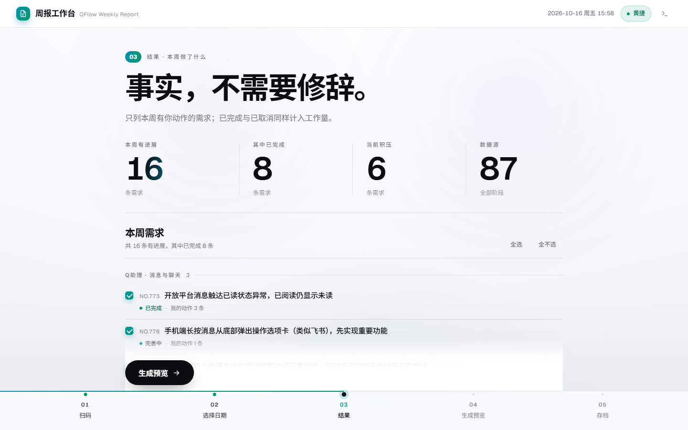

# QFlow 周报工作台

扫码登录 Q助理 → 拉取 QFlow 本周工作内容 → 生成周报 → 存进本地文件夹。

**纯静态网站，无后端、无构建、无依赖安装。** 所有请求都在用户浏览器里完成，服务器不接触任何凭据。


## 五幕流程

界面按发布会的方式组织：一屏一幕，换幕即换强调色，底部幕次导轨只能顺序解锁。

| 幕 | 做什么 | 产出 |
|---|---|---|
| 01 扫码 | 手机 Q助理 App 扫码，自动换取 QFlow 令牌 | 登录态 |
| 02 选择日期 | 默认上周五 14:00 ~ 本周五 14:00，可自定义 | 统计窗口 |
| 03 结果 | 拉取你参与过的全部需求，只列本周有你动作的 | 指标 + 需求清单 |
| 04 生成预览 | 周报 Markdown 全文逐行过目 | 报告正文 |
| 05 存档 | 选定目录写盘，目录授权只需给一次 | 本地 `.md` 文件 |



## 快速开始

```bash
cd weekly-report
python -m http.server 8899
```

打开 <http://127.0.0.1:8899/>，用 **Chrome 或 Edge**（目录选择 API 仅 Chromium 支持，其它浏览器自动降级为下载）。

要发布到线上，把整个 `weekly-report/` 目录丢给任意静态托管即可（Nginx / Pages / OSS）。唯一前提是浏览器能访问 `client.qzhuli.com` 与 `qflow.qzhuli.cn`。

## 仓库结构

```
├─ weekly-report/        工作台本体（界面、流程编排、接口层、测试）
│  └─ README.md          ← 使用手册、周报格式、常见问题、技术说明在这里
├─ docs/
│  ├─ superpowers/specs/ 设计文档（需求、可行性验证、架构、验收标准）
│  └─ screens/           逐幕截图
```

## 为什么不需要后端

已实测，不是推测：

- `client.qzhuli.com` 返回 `Access-Control-Allow-Origin: *`，`qflow.qzhuli.cn` 预检回显 Origin
- 浏览器端 MD5 与 Node 结果逐字符一致，签名 → SSO → QFlow 令牌 → 取数全链路在浏览器内跑通

## 取数口径（本项目最容易踩的坑）

`requirement_user_filter=participated` 单独使用**只返回进行中的需求**，全部「已完成」会被静默丢弃。

正确做法是 `participated` + 逐 `progress_stage` 拉取。实测同一窗口：单独用 19 条，逐阶段拉取 **87 条**。修复前本周只统计到 6 条需求，修复后为 **16 条**——验收完成同样代表工作量，不该被丢掉。

## 测试

```bash
cd weekly-report
node tests/run-all.mjs          # Node 套件（vendor / week / sign / classify / report / 在线三套）
```

浏览器端另有两个套件，用 Chrome 打开或无头 `--dump-dom` 读 `<title>`：

| 页面 | 覆盖 |
|---|---|
| `weekly-report/tests/browser-test.html` | 69 项：模块加载、指标数值、DOM 齐全、五幕结构、幕次状态机防跳步、分组渲染 |
| `weekly-report/tests/design-test.html` | 45 项：字体实际生效、白场令牌、幕次色随 `data-step` 切换、巨型主题字、对比度 AAA/AA |

> `qflow` / `flow` / `e2e` 走真实接口，需要 `~/.qzhuli-cli` 里的令牌未过期；报 `AUTH_EXPIRED` 是令牌问题，与代码改动无关。

## 已知限制

1. 依赖 Q助理内部接口，官方开放平台无 QFlow 数据能力；接口改版需改 `weekly-report/src/qflow.js`
2. `participated` 只覆盖「当前仍参与」的需求，事后被移出参与人的会漏
3. 积压口径为「当前负责人是我」，非「所有我参与且未完成」
4. 板块归类沿用公司既有规则，未命中关键词的归入「通用/未分类」

细节与决策依据见 [设计文档](docs/superpowers/specs/2026-10-16-weekly-report-generator-design.md)。
