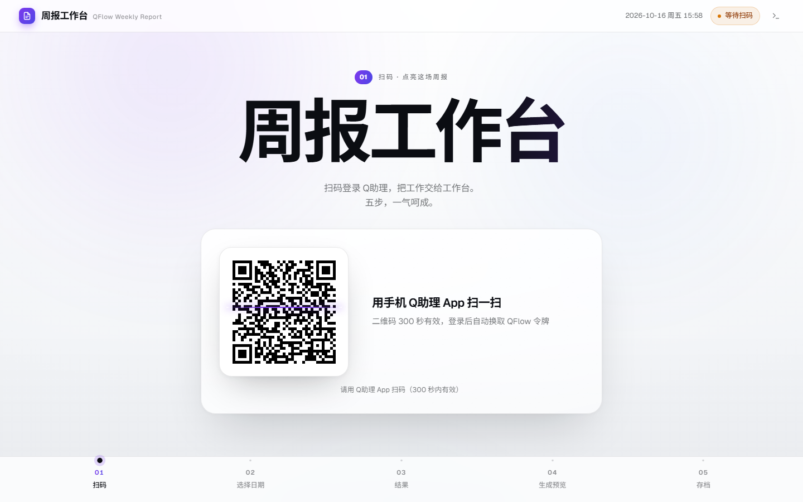

# QFlow 周报工作台

扫码登录 Q助理 → 拉取 QFlow 本周工作内容 → 生成周报 → 存进本地文件夹。

## 五幕流程

界面按发布会的方式组织：一屏一幕，换幕即换强调色，底部幕次导轨只能顺序解锁。

| 幕 | 做什么 | 产出 |
|---|---|---|
| 01 扫码 | 手机 Q助理 App 扫码，自动换取 QFlow 令牌 | 登录态 |
| 02 选择日期 | 默认上周五 14:00 ~ 本周五 14:00，可自定义 | 统计窗口 |
| 03 结果 | 拉取你参与过的全部需求，只列本周有你动作的 | 指标 + 需求清单 |
| 04 生成预览 | 周报 Markdown 全文逐行过目 | 报告正文 |
| 05 存档 | 选定目录写盘，目录授权只需给一次 | 本地 `.md` 文件 |

